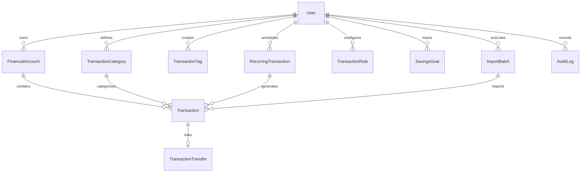

# Expense Tracker Architecture & Data Design

## 1. Domain Model Design

## 2. Invariants & Financial Integrity Rules

1. **Atomic Transfers**: A transfer consists of two linked transaction records or a single transfer record with `sourceAccountId` and `destinationAccountId`. In our relational schema, a `TransactionTransfer` record atomically links the outgoing debit transaction and the incoming credit transaction under one database transaction. Modifying or deleting either side automatically updates or voids the paired side.
2. **Decimal Storage**: Stored as `NUMERIC(15, 2)` in PostgreSQL and handled as `Decimal` in Prisma and TypeScript.
3. **Reconciliation Guarantee**: For any account $A$:
   $$\text{Balance}(A) = \text{InitialBalance}(A) + \sum \text{Income}(A) - \sum \text{Expense}(A) + \sum \text{TransfersIn}(A) - \sum \text{TransfersOut}(A)$$
   A reconciliation service method validates that cached account balances match the exact sum of active transactions.
4. **Deterministic Rule Engine**: Rules execute in ascending `priority` order. Each rule evaluates predicates against the normalized transaction attributes. History is never re-written unless the user explicitly requests a batch retroactive rule execution.
