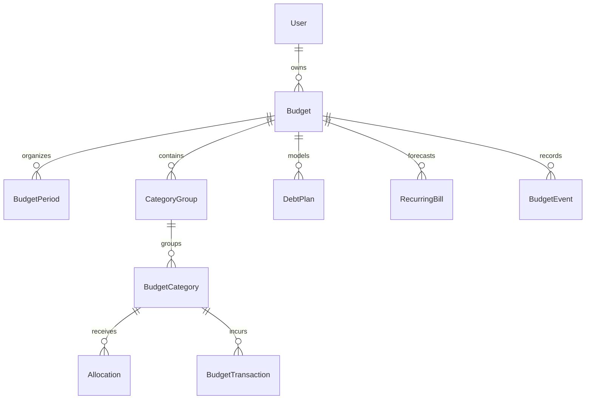

# Budget Planning App Architecture & Event Model

## 1. Domain Entities & Relationships

## 2. Event Sourcing & Invariant Engine
1. **Append-Only Event Store**: Any allocation adjustment, category transfer, or initial balance modification appends a `BudgetEvent` with an idempotency key, sequence counter, and JSON metadata.
2. **Deterministic State Rehydration**: Running the `replayEvents()` reducer across the event sequence produces the exact current category available balances and Ready-to-Assign figure.
3. **Local-First Synchronization**: Client events generated with UUIDs synchronize with the central store. When conflicts arise, vector timestamps and deterministic server-side merge rules guarantee eventual consistency without data loss.
