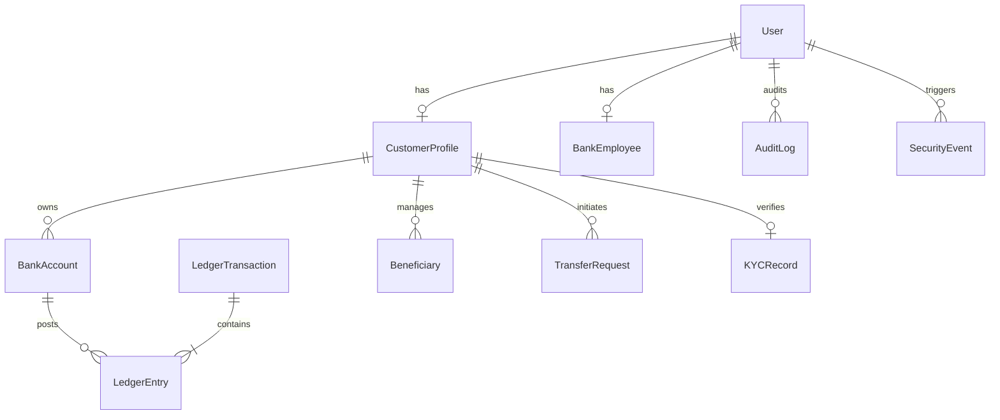

# Banking Application Architecture & Double-Entry Ledger Design

## 1. Relational Entity Architecture

## 2. Double-Entry Accounting Model
In banking accounting:
- **Asset Accounts** (Cash in Vault, Customer Receivables): Debits increase, Credits decrease.
- **Liability Accounts** (Customer Bank Deposit Accounts): Credits increase customer balance, Debits decrease customer balance.

When customer $A$ transfers $\$500.00$ to customer $B$:
1. A single `LedgerTransaction` is opened with state `COMPLETED`.
2. `LedgerEntry 1`: Account $A$ is **Debited** for $\$500.00$ (liability decreases).
3. `LedgerEntry 2`: Account $B$ is **Credited** for $\$500.00$ (liability increases).
4. Zero-Sum Invariant: $\text{Debit} - \text{Credit} = 500.00 - 500.00 = 0.00$.
5. Written in a single atomic PostgreSQL transaction with row locks on accounts to prevent race conditions.
